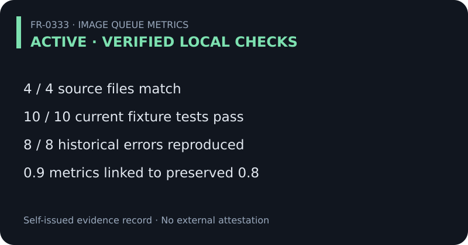
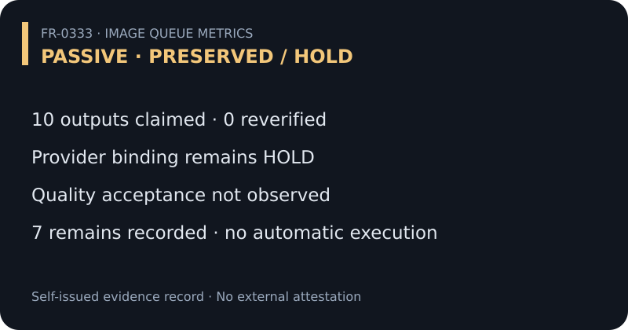

# FR-0333 image queue metrics

Golden Chain **0.9** extends preserved entry **0.8**. Reference: PR #70 at `417f4094e1df8fe3c332177d2ac3698af62317c7`.




## Active and passive lanes

| Lane | Metric | Result | What it establishes |
| --- | --- | --- | --- |
| ACTIVE | A.1 source hashes | 4 matched of 4 | Current and historical Python bytes agree with the original record |
| ACTIVE | A.2 current tests | 10 passed of 10 | Simulated dispatch/reconciliation behavior |
| ACTIVE | A.3 historical tests | 8 errors in 8 tests · exit 1 | Expected callback failure reproduced locally |
| ACTIVE | A.4 retained job log | 1 hash matched of 1 | Retained bytes match the recorded hash; provenance is separate |
| ACTIVE | A.5 receipt 0003 | 1 blob matched of 1 | Existing document binding; no image-byte proof |
| ACTIVE | A.6 index preservation | 8 earlier entries retained | Prefix matches bound pre-change index snapshot |
| PASSIVE | P.1 final images | 10 claimed · 0 reverified here | Output-byte verification remains HOLD |
| PASSIVE | P.2 acceptance | NOT_OBSERVED | Quality promotion remains HOLD |
| PASSIVE | P.3 independent attestation | NOT_ESTABLISHED | All new certificates are self-issued |

ACTIVE means authorized local checks. PASSIVE means preserved claims and unresolved evidence. Neither lane schedules background work. Passive records cannot execute providers or promote themselves. IDs A.1 through A.6 and P.1 through P.3 are local metric identifiers, not a change to the Genius vector.

## Read and write records

- [Metrics](fr0333_image_queue_metrics_0001.json)
- [Original 0.8 record](fr0333_image_queue_failure_closure_0001.json): preserved without rewriting the failure
- [Execution receipt](fr0333_image_queue_metrics_execution_0001.json): timestamp · interpreter · commands · exit codes · hashed local logs
- [Remains certificate](fr0333_image_queue_remains_certificate_0001.json): R.1 through R.7 · explicit evidence needed
- [Golden Chain index](fr0333_golden_chain_index_0001.json): 0.9 links these metrics back to 0.8

Certificates record local evidence and gaps. They are not signatures, external certification, independent attestation, or operator acceptance.

## Offline rerun

From the repository root:

```sh
python RavenCloudTaskbar/validate_image_queue_failure_closure_0001.py
python -O RavenCloudTaskbar/validate_image_queue_failure_closure_0001.py
python RavenCloudTaskbar/validate_image_queue_metrics_0001.py
python -O RavenCloudTaskbar/validate_image_queue_metrics_0001.py
python RavenCloudTaskbar/test_image_queue_metrics_0001.py
```

Both validators use explicit exceptions. Optimization cannot remove their checks. The regression suite mutates copied evidence to test rejection of promotion, passive execution, inflated metrics, changed output claims, and broken index links. No validator invokes a provider, workflow, network request, or image transformation. The metrics validator reads retained execution logs; it does not silently rerun the runtime suites.

## Smallest remaining delivery gate

Read existing receipt 0003 outputs and retained provider responses. For Q01 through Q10 bind slot ID · generation or retry request ID · normalization request ID · final URL · resolved asset · retrieval timestamp · nonzero byte count · decoded image SHA-256 · measured 1080×1920 dimensions. Retain Q09 initial failure and retry evidence. Add dated visual review bound to output hashes. Approval and mainline merge remain separate.

Raw annotations and independent log provenance remain open. Native 1072×1920 and normalized 1080×1920 are distinct claims. Fixture dimension replacement does not perform resizing. The nine regression tests are validator tests and do not add image outputs to the ten-test runtime suite.

## Rollback and anti-loop

Drop this follow-up commit to restore the previous draft. Keep prior 0.1 through 0.8 entries unchanged. Repeat runtime checks only for new evidence, code changes, or explicit user authorization; do not regenerate successful image slots. This package contains no provider runner, scheduler, or merge action.
